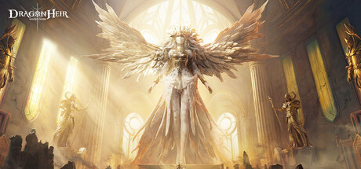

Hi, I'm **Yufeng Huang** — a game AI and tools engineering lead with 8+ years of industry experience at Tencent, ByteDance, and NetEase. My work spans behavior-based NPC intelligence, LLM-driven agents, AI-assisted production workflows, and generative AI for games.

At [Tencent SGRA Studio](https://sgrastudio.com/), I lead the studio's tools engineering team and serve as its Game AI lead. I design hybrid NPC architectures that combine behavior trees, finite-state machines, utility AI, and LLM-based modules. I also lead the development of 10+ LLM-powered authoring tools for narrative, dialogue, behavior trees, levels, and cinematics, while exploring agent-driven tool generation and multi-agent approaches to general-purpose game generation.

## Research interests

My research interests sit at the intersection of **AI for games, intelligent interactive agents, and human-AI co-creation**. I am particularly interested in how AI agents can act as collaborative partners that augment human game designers throughout the creation process.

- Human-AI co-creation of games
- Interactive and autonomous virtual agents
- Multi-agent systems for creative and interactive tasks
- Game-playing AI and generative AI for games

I am open to research collaborations and conversations.

## Titles I've worked on

  

    

      
    

    

      <h3 class="game-card-title">Animula Nook</h3>
      wishlists open
      
A cozy miniature life-sim where you shrink down and build a whimsical world on your desk. I lead tools engineering and Game AI, developing hybrid NPC intelligence and 10+ LLM-powered authoring tools.

      

        <a href="https://store.steampowered.com/app/3767320/Animula_Nook/">Steam</a>
        <a href="https://www.wegame.com.cn/store/2002539/Animula_Nook">WeGame</a>
        <a href="https://animulanook.com/en/">Official Site</a>
      

    

  

  

    

      
    

    

      <h3 class="game-card-title">Dragonheir: Silent Gods</h3>
      launched 2023
      
An open-world high-fantasy strategy RPG with D&amp;D content. I built the tactical combat AI and an event-driven NPC narrative system powering 1,000+ concurrent NPCs per scene.

      

        <a href="https://store.steampowered.com/app/2203070/Dragonheir_Silent_Gods/">Steam</a>
        <a href="https://dragonheir.sgrastudio.com/">Official Site</a>
        <a href="https://apps.apple.com/app/dragonheir-silent-gods/id1677498498">App Store</a>
      

    

  

  

    

      
    

    

      <h3 class="game-card-title">Onmyoji Arena</h3>
      launched 2018
      
NetEase's flagship MOBA with elegant Heian-era aesthetics. I shipped various gameplay systems including hero skills, activities, battle pass, and more.

      

        <a href="https://www.onmyojiarena.us/">Official Site</a>
        <a href="https://apps.apple.com/app/onmyoji-arena/id1343073274">App Store</a>
        <a href="https://play.google.com/store/apps/details?id=com.netease.g78na.gb">Google Play</a>
      

    

  

## Background

Before Tencent, I was a **Senior Software Engineer at ByteDance Nuverse** (June 2021–December 2023 and February–July 2024), where I developed tactical combat AI, multi-phase boss AI, large-scale narrative NPC systems, open-world ambient behavior, generative AI workflows, and production tools across multiple game projects. At **NetEase Games** (July 2017–July 2019 and April 2020–June 2021), I shipped gameplay systems for _Onmyoji Arena_ and built companion AI for an internal open-world MMORPG.

I received my **M.Eng. in Pattern Recognition and Intelligent Systems** from Huazhong University of Science and Technology (HUST), where my thesis focused on CNN-based visual place recognition. My **B.Eng.** is also from HUST.

## Beyond work

A few other things that make me, me:

- **Indie dev on the side** — building my own games, apps, and tools around small problems worth solving, with the quiet belief that good products can make life a little better.
- **A sucker for stories** in any form — novels, films, TV series, games — and slowly writing a novel of my own.
- **Always plotting the next trip.** Life is a collection of experiences; I want to collect as many people, stories, and skylines as possible — from this planet outward.
- **Latiao** (辣条), my Maltese, who is small, fluffy, and fully in charge of the household.

---

For more details, see my [CV](/cv/), [GitHub](https://github.com/dreamhungry), or [LinkedIn](https://www.linkedin.com/in/dreamhungry/).
